# Nokia CMG Reachability Tracker Generator 📡

An automated, self-healing engineering tool for 4G/5G **Nokia Cloud Mobility Gateway (CMG)** modernizations and deployments. 

This platform ingests raw engineering source files (**CIQ**, **UP-DATA IP-Plan**, and **UP-IMS IP-Plan**), performs schema and integrity validation, extracts dynamic transport interfaces and external core peers, and compiles a standardized Nokia Reachability Tracker Excel workbook (`.xlsx`) complete with automated **CMG Ping**, **DCGW Ping**, and **CMG Traceroute** CLI test scripts.

---

## 🌟 Key Features

* **🛡️ Pre-Upload Validation Gateway**: Automatically validates file openxml integrity, checks mandatory sheet structures, detects role mix-ups (e.g., uploading an IMS plan as CIQ), and halts invalid inputs with clear guidance.
* **🔍 Dynamic Column & Header Discovery**: Resilient to column shifts, merged cells, and variable header names across circles (`S1U-eNb`, `S1U_eNodeB`, `UP-DATA_S1U`).
* **🌐 Multi-Circle Intelligence**: Supports automated site name and circle detection for **Karnal / Haryana**, **Mohali / Punjab**, **Lucknow / UP East**, **Delhi**, **Gujarat**, **Mumbai**, **Maharashtra**, and **National Generic** profiles.
* **⚡ Self-Healing Fallback Engine**:
  * **Populated CIQs**: Dynamically extracts live circle peers (`S11 MME`, `Gx PCRF`, `Gy OCC/RECC`, `S6b AAA`, `X1/X2/X3`, `S2b ePDG`, `SBC Gm`).
  * **Blank / Draft CIQs**: Automatically fills missing destinations with regional circle profiles or national fallback defaults, guaranteeing Column E (`CMG SRC Address`) and Column G (`DST Address`) are never empty.
* **🛡️ Zero-Crash Bounds Protection**: Utilizes modulo group indexing (`grp[i % len(grp)]`) and optional sheet loaders so length mismatches and missing optional sheets will never crash the system.
* **📊 Dual Mode Interface**: Available as both a modern dark-mode **Streamlit Web Application** and an autonomous **Command Line Interface (CLI)**.

---

## 🏗️ Architecture & Dataflow

```mermaid
flowchart LR
    %% Node Styles
    classDef inputStyle fill:#1e293b,stroke:#38bdf8,stroke-width:2px,color:#f8fafc;
    classDef procStyle fill:#0f172a,stroke:#818cf8,stroke-width:2px,color:#f8fafc;
    classDef guardStyle fill:#1e1b4b,stroke:#c084fc,stroke-width:2px,color:#f8fafc;
    classDef outputStyle fill:#064e3b,stroke:#34d399,stroke-width:2px,color:#f8fafc;
    classDef coreStyle fill:#172554,stroke:#60a5fa,stroke-width:2px,color:#f8fafc;

    subgraph Inputs ["1. Input Workbooks"]
        CIQ["Nokia CIQ Questionnaire<br/>• S11, Gx, Gy, S6b, S2b<br/>• S1U-eNb, Gn-Gp-S5-S8<br/>• SBC Gm, UE IP Pools"]:::inputStyle
        DATA["UP-DATA IP-Plan<br/>• CP/UP1 System IPs & SX<br/>• VPRN SIDs (Signal, Bill, Core)<br/>• NAT Inside Pool (SGi)"]:::inputStyle
        IMS["UP-IMS IP-Plan<br/>• UP2 System IP & SX<br/>• UP-IMS Service IDs"]:::inputStyle
    end

    subgraph Validation ["2. Format Validation Gateway"]
        ValCheck["validate_all_source_files()<br/>• Openpyxl Integrity Check<br/>• Role Schema Matching<br/>• Mandatory Sheet Audit"]:::guardStyle
        FailStop{"All 3 Files<br/>Valid?"}:::guardStyle
        Abort["Abort & Display<br/>Detailed Actionable Errors"]:::guardStyle
    end

    subgraph Extractor ["3. Dynamic Discovery & Extraction"]
        SheetNorm["Sheet Name Normalizer<br/>• Aliases & Substrings<br/>• Regional Suffix Matching"]:::procStyle
        ColScan["Dynamic Column Scanner<br/>• Header Regex Match<br/>• Shift & Offset Immunity"]:::procStyle
        Collector["Endpoint Collector (collect)<br/>• Loopbacks: CP, UP1, UP2<br/>• VPRN Service IDs (grp1, grp2)<br/>• Targets: MME, PCRF, OCC, SBC"]:::procStyle
    end

    subgraph Profiler ["4. Circle Profiler & Fail-Safe Engine"]
        CircDetect["Circle & Site Resolver<br/>(Karnal, Mohali, Lucknow, Generic)"]:::coreStyle
        Fallback["Self-Healing Fallbacks<br/>• Blank CIQ -> Regional Peers<br/>• Missing Source -> Loopback Backfill<br/>• Modulo Indexing: grp[i % len(grp)]"]:::coreStyle
    end

    subgraph MatrixEngine ["5. Reachability Matrix & CLI Compiler"]
        BlockBuild["build_blocks()<br/>• 27 Standard Protocol Blocks<br/>• CPF, UPF-1 Data, UPF-2 IMS"]:::procStyle
        ScriptGen["CLI Automation Formulas<br/>• Col P: CMG Ping CLI Script<br/>• Col Q: DCGW Ping CLI Script<br/>• Col S: CMG Traceroute CLI Script"]:::procStyle
    end

    subgraph Delivery ["6. Standard Nokia Tracker Workbook"]
        OutputWb["Reachability Tracker (.xlsx)<br/>• Summary Rollup (First Call / F-UAT)<br/>• Reachability Details (378-416 rows)<br/>• Help & Engineering Documentation"]:::outputStyle
    end

    CIQ & DATA & IMS --> ValCheck
    ValCheck --> FailStop
    FailStop -- "No" --> Abort
    FailStop -- "Yes" --> SheetNorm
    SheetNorm --> ColScan --> Collector
    Collector --> CircDetect --> Fallback
    Fallback --> BlockBuild --> ScriptGen
    ScriptGen --> OutputWb
```



---

## 🚀 Getting Started Locally

### Prerequisites
* Python 3.9+ (Python 3.10, 3.11, or 3.12 recommended)
* pip package manager

### 1. Clone the Repository
```bash
git clone https://github.com/<your-username>/reachability-tracker.git
cd reachability-tracker
```

### 2. Install Dependencies
```bash
pip install -r requirements.txt
```

### 3. Launch the Web Application
```bash
streamlit run app.py
```
*(On Windows, you can simply double-click `run_app.bat`)*

Open your browser to `http://localhost:8501`.

---

## 💻 CLI Usage

You can also run the generator directly from the terminal without launching the web server:

```bash
python "reachability tracker.py" --input-dir "/path/to/circle/files" --site "Karnal-2" --out "Reachability_Tracker.xlsx"
```

Options:
* `--input-dir`, `-i`: Directory containing the 3 source Excel files (`*CIQ*.xlsx`, `*UP-DATA-IP-Plan*.xlsx`, `*UP-IMS-IP-Plan*.xlsx`).
* `--site`, `-s`: Site identifier (e.g., `Karnal-2`, `Mohali-5`). Auto-detected if omitted.
* `--out`, `-o`: Output `.xlsx` filename.

---

## ☁️ Deployment Guide

### Deploying to Streamlit Community Cloud (Free & Instant)

1. **Push to GitHub**:
   Ensure you push this repository to your GitHub account (the `.gitignore` is already set up to exclude proprietary circle data folders like `Data 1`, `Data 2`, `Data 3` and all customer `.xlsx` files).
2. **Open Streamlit Cloud**:
   Go to [share.streamlit.io](https://share.streamlit.io/) and log in with your GitHub account.
3. **Create New App**:
   * **Repository**: `<your-username>/reachability-tracker`
   * **Branch**: `main` (or `master`)
   * **Main file path**: `app.py`
4. **Click Deploy**:
   Streamlit Cloud will read `requirements.txt`, install dependencies, apply `.streamlit/config.toml`, and launch your application at a permanent public URL (e.g., `https://reachability-tracker.streamlit.app`).

---

## 📋 Required Source File Formats

The application expects 3 standard Nokia engineering files:

| Document | Filename Pattern | Mandatory Sheet Dependencies |
| :--- | :--- | :--- |
| **Nokia CMG CIQ** | `*CIQ*.xlsx` | `S11`, `Gx`, `Gy`, `S6b`, `X1-X2-X3`, `S1U-eNb`, `Gn-Gp-S5-S8`, `S2b`, `P-CSCF_SBC`, `UE IP pool` |
| **UP-DATA IP-Plan** | `*UP-DATA-IP-Plan*.xlsx` | `External Interfaces`, `CP-SIGNAL`, `CP-BILLING`, `CP-LI`, `CP-CORE`, `UP-CORE`, `NAT_13XX_INSIDE VPRN` |
| **UP-IMS IP-Plan** | `*UP-IMS-IP-Plan*.xlsx` | `External Interfaces`, `UP-CORE`, `UP-IMS` |

---

## 🔒 Security & Privacy

* **In-Memory Processing**: Uploaded files and generated tracker workbooks are processed in memory streams (`io.BytesIO`) and are not stored permanently on the server.
* **Proprietary Data Protection**: All customer-specific test datasets (`Data 1`, `Data 2`, `Data 3`) and client `.xlsx` sheets are strictly blocked from git tracking via `.gitignore`.
